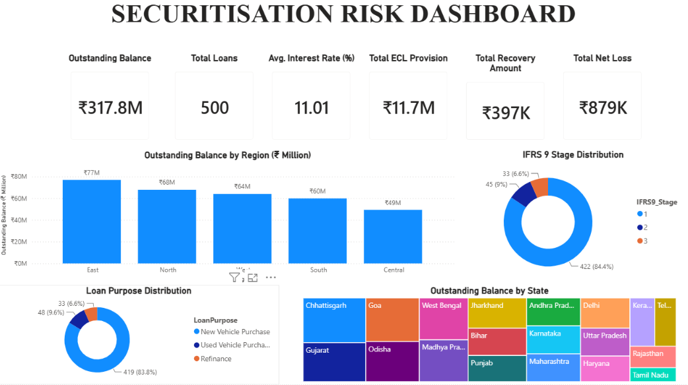
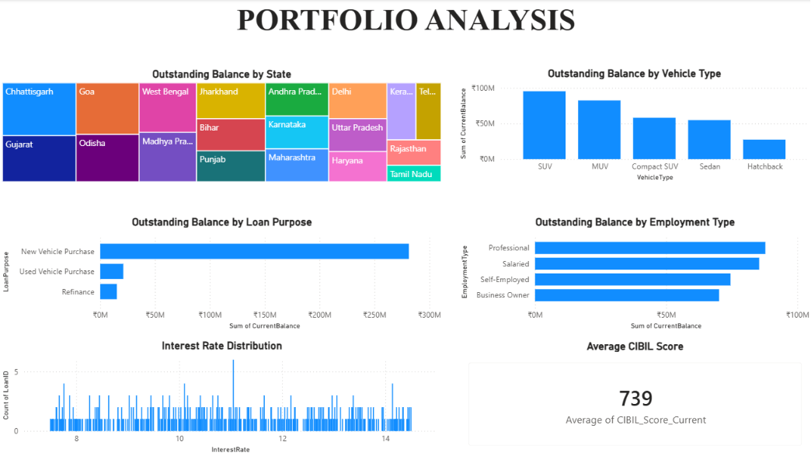
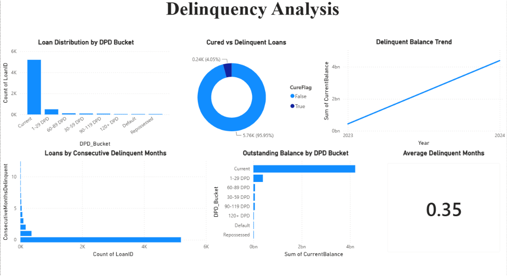
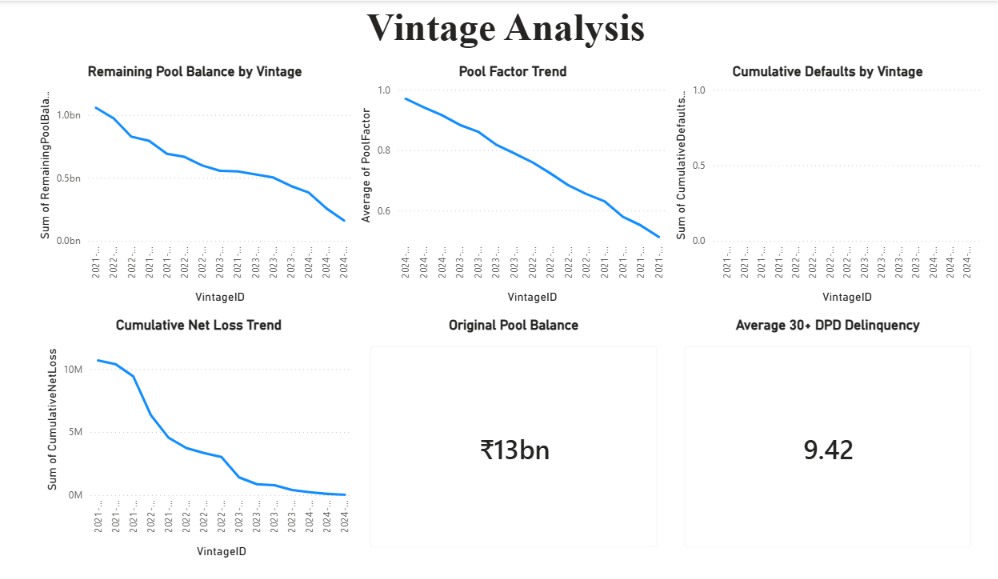
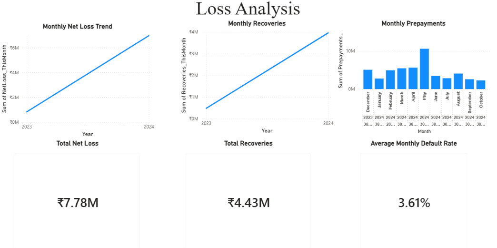
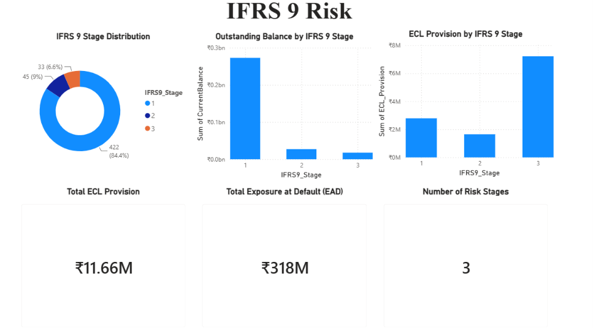
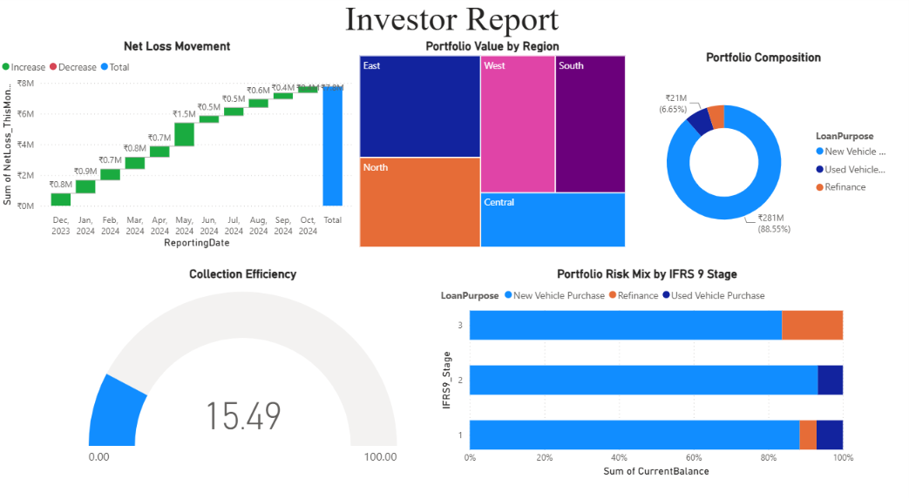

# 📊 Securitisation Risk Dashboard

A comprehensive Power BI dashboard developed to analyze the performance and risk profile of an auto loan securitisation portfolio. The dashboard provides insights into portfolio composition, delinquency trends, credit losses, IFRS 9 risk stages, vintage performance, and investor-focused portfolio summaries.

---

## 📌 Project Overview

The objective of this project is to build an interactive business intelligence dashboard that helps financial institutions and investors monitor the health and performance of a securitised loan portfolio.

The dashboard transforms raw loan-level and portfolio-level datasets into meaningful visual insights for credit risk monitoring and investment decision-making.

---

## 🎯 Objectives

- Analyze portfolio composition across regions and loan purposes.
- Monitor delinquency and repayment behavior.
- Track vintage performance over time.
- Analyze monthly losses, recoveries, and prepayments.
- Evaluate portfolio risk using IFRS 9 staging.
- Present an investor-friendly summary of portfolio performance.

---

# 📷 Dashboard Preview

## Executive Dashboard



---

## Portfolio Analysis



---

## Delinquency Analysis



---

## Vintage Analysis



---

## Loss Analysis



---

## IFRS 9 Risk Analysis



---

## Investor Report



---

# 📁 Dataset

This project uses the following datasets for analysis:

- auto_loan_securitisation_data.csv
- dpd_snapshot_history.csv
- dynamic_loss_monthly.csv
- static_pool_vintage_data.csv

---

# 🛠️ Tools & Technologies

- Microsoft Power BI Desktop
- Power Query
- DAX (Data Analysis Expressions)
- Data Modeling
- Data Visualization
- Microsoft Excel / CSV Files
- Git
- GitHub

---

# 📈 Key Business Insights

This dashboard helps answer important business questions such as:

- Which region has the highest outstanding portfolio?
- Which loan purpose contributes the highest exposure?
- How is portfolio risk distributed across IFRS 9 stages?
- What are the monthly recovery and net loss trends?
- Which vintage pools are performing better?
- How is delinquency distributed across DPD buckets?
- What is the Expected Credit Loss (ECL) for the portfolio?

---

# 📂 Repository Structure

```text
Securitisation-Risk-Dashboard
│
├── images
│   ├── executive_dashboard.png
│   ├── portfolio_analysis.png
│   ├── delinquency_analysis.png
│   ├── vintage_analysis.png
│   ├── loss_analysis.png
│   ├── ifrs9_risk.png
│   └── investor_report.png
│
├── Securitisation_Risk_Dashboard.pbix
├── auto_loan_securitisation_data.csv
├── dpd_snapshot_history.csv
├── dynamic_loss_monthly.csv
├── static_pool_vintage_data.csv
├── 483553A_Data_Analyst_Securitisation.pdf
└── README.md
```

---

# 🚀 How to Use

1. Clone this repository.
2. Open `Securitisation_Risk_Dashboard.pbix` using Microsoft Power BI Desktop.
3. Ensure all CSV files remain in the same directory if prompted.
4. Refresh the data if required.
5. Explore the dashboard using the report tabs.

---

# 🔮 Future Improvements

- Live database integration
- Automated data refresh
- Predictive credit risk analytics
- Interactive drill-through reports
- Row-Level Security (RLS)

---

# 👨‍💻 Author

**Shrihari Kulkarni**

Engineering Student | Data Analytics Enthusiast

GitHub: https://github.com/Shrihari-Kulkarni04

---

⭐ If you found this project useful, consider giving this repository a star.